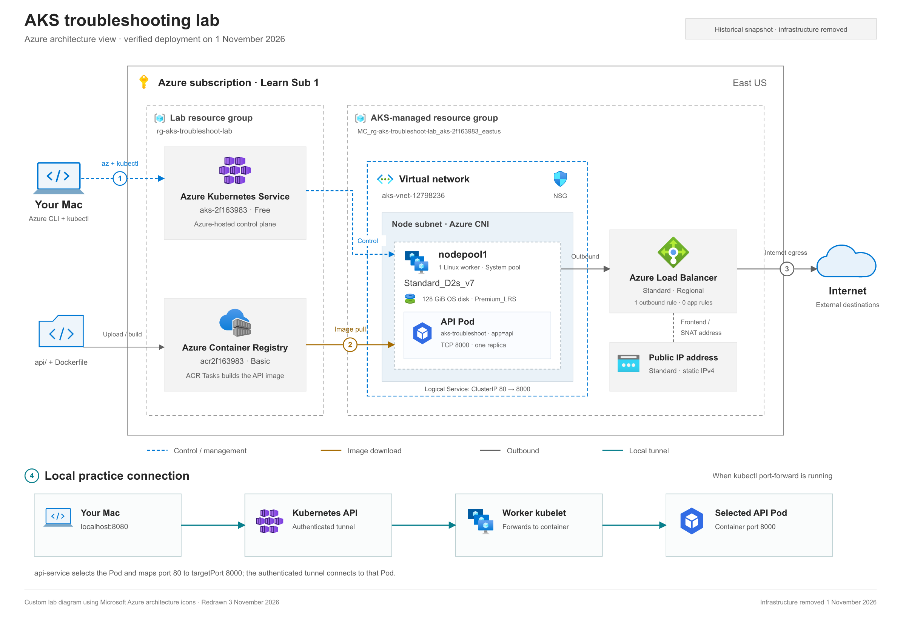

# AKS troubleshooting lab plan

Planning date: October 30, 2026. Source links are in [references/SOURCES.md](references/SOURCES.md).

## What we will learn

Trace an application's failure through its Service, pod, configuration, and readiness checks. Each exercise follows the same loop: observe a symptom, collect evidence, identify the cause, apply one repair, and verify recovery.

## Architecture

[Open scalable SVG](notes/aks-lab-architecture.svg) · [Architecture explanation and numbered flows](notes/ARCHITECTURE.md). Redrawn November 3 using Azure Architecture Center visual conventions; the image represents the verified deployment before cleanup.

The managed resource group and its contents depend on the deployed cluster configuration. The local port-forward does not by itself require exposing the app through a public application load balancer. AKS outbound networking can still create billable network resources. Last deployed configuration, verified November 1 before cleanup: one D2s_v7 node, 128-GiB managed Premium_LRS OS disk, AKS Free, ACR Basic, one Standard IPv4 and one outbound LB rule; no add-ons.

## Milestones

| Stage | Work | Completion evidence | State |
| --- | --- | --- | --- |
| 0 | Set up local project, map lab, estimate cost | Project files and reproducible chart | Complete |
| 1 | Import official starter files and inspect deployment | Nine-file SHA-256 inventory and source review; archive/commit unavailable | Source inspected; provenance unverified |
| 2 | Validate environment and subscription | Paid offer eligibility, regional SKU availability, quota, permissions, providers, compatible tools | Complete; provisioning capacity still subject to Azure |
| 3 | Review final cost and deploy when requested | Actual settings match estimate; ACR image built; AKS ready | Complete November 1: recreated ACR/image and AKS; actual configuration verified |
| 4 | Verify healthy starting state | Ready node/pod, populated EndpointSlice, three HTTP 200 responses | Complete again November 1; fresh baseline HTTP/readiness verified |
| 5 | Investigate Service label mismatch | User reported complete; live selector/Pod labels/ready EndpointSlice verified before teardown | Complete October 31; see notes/SCENARIO-1.md |
| 6 | Investigate container restart loop | Logs identify missing environment variable; pod recovers | Recovery verified before scenario 3; exact user repair invocation not captured |
| 7 | Investigate readiness failure | Events identify wrong probe path; rollout completes after repair | Fault and recovery verified; final readiness path /healthz, Pod Ready and backend ready |
| 8 | Verify all endpoints and clean up | Deployment stopped before exercises; verify deletion and check billed usage later | Final November 1 cleanup verified: all lab groups absent and inventories empty; billed usage review pending |

## Before deployment

- Confirm subscription `Learn Sub 1` is the intended paid offer. Its name and Enabled state do not establish ACR build eligibility, credits, permissions, or quota.
- Inspect the starter archive before running anything. Capture the actual script and manifest settings in the journal.
- Use resource group `rg-aks-troubleshoot-lab` only if it is absent or contains exclusively this lab.
- Check VM-family and regional vCPU quota. `Standard_D2s_v7` has 2 vCPUs per node; allow for any required surge capacity. Query the actual VM family, not a SKU name, in quota output.
- Check registration of ContainerService, ContainerRegistry, Compute, Network, and Storage. Register only as part of the authorized deployment phase.
- Confirm Python 3.12+ and a kubectl version compatible with the AKS server.
- Resolve the cost report's open assumptions. A paid AKS control-plane tier, additional nodes, NAT Gateway, monitoring ingestion, or different disks changes the estimate.
- Choose a session duration that includes provisioning, troubleshooting, and resource deletion. The lab describes about 30 minutes of exercise time plus 10–15 minutes of resource deployment; reserve 2 hours for a first pass.

## Completion

Record each fault's symptom, command output, root cause, repair, and verification. Finish by deleting the dedicated lab resource group after checking its contents. Confirm the AKS-managed node resource group also disappears; investigate leftovers instead of assuming a background deletion completed. Record actual billed usage once Azure Cost Management has updated.

## Current stop point

Infrastructure is removed. [Cleanup verification](notes/LAB-JOURNAL.md#teardown--november-1) confirms the lab, AKS-managed and automatic Network Watcher groups are absent and subscription-wide resource/group inventories are empty. Before teardown, [final live checks](notes/LAB-JOURNAL.md#3-running-container-failed-readiness--november-1) verified the repaired API configuration, Ready Pod and ready Service backend. The [shortened journal](notes/LAB-JOURNAL.md) records commands, reasons and results for all three scenarios. Local files are retained. Actual billed usage remains unchecked; redeploy only when requested and after fresh preflight/cost review.
