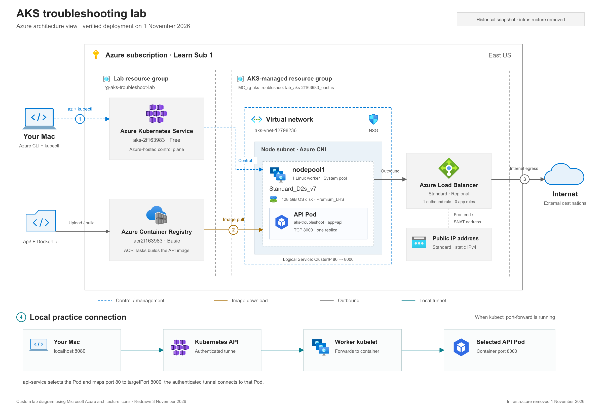

# AKS lab architecture

Redrawn November 3, 2026 with the visual conventions and official icons used by the Azure Architecture Center. This shows the **verified November 1 deployment** before its teardown; it is a historical learning diagram. [The journal records November 1 cleanup verification](LAB-JOURNAL.md#teardown--november-1).



[Open full-size PNG](aks-lab-architecture.png) · [Open scalable, editable SVG](aks-lab-architecture.svg)

## Follow the numbered connections

| Flow | What happens in this lab |
| --- | --- |
| **1 — Management** | Your Mac uses Azure CLI to provision/inspect Azure resources and kubectl to manage the Kubernetes API. The AKS resource is in the lab group; Azure hosts the control plane. Its dashed control connection represents management of the worker. |
| **2 — Image delivery** | Local `api/` and Dockerfile are uploaded to ACR Tasks. The built `aks-troubleshoot-api:latest` image is stored in `acr2f163983`. The worker downloads it using its kubelet identity's AcrPull permission. |
| **3 — Outbound network** | The single Linux worker is in the Azure CNI node subnet. The Standard Regional load balancer has one outbound rule and uses its static public-IP frontend for SNAT. It has zero application load-balancing rules. The public-IP connection is an association, not a separate forwarding appliance. |
| **4 — Local practice** | `kubectl port-forward` opens an authenticated stream through the Kubernetes API and worker kubelet to a selected Pod. The Service name selects the Pod and resolves port `80 → 8000`; this tunnel bypasses the Service virtual IP and the public load balancer. |

The dashed blue rectangle is the VNet; gray dashed rectangles are resource groups or worker capacity. The shaded subnet contains the single system node-pool worker and its API Pod. The load-balancer and public-IP symbols show Azure network resources outside that subnet boundary. Subnet name and CIDR are omitted because they were not retained in the saved evidence. System Pods, the kubelet identity resource and Network Watcher are omitted for clarity.

## Connect the picture to troubleshooting

These Kubernetes objects are logical configuration, not additional Azure VMs:

| Object | Healthy configuration | What the exercise changed |
| --- | --- | --- |
| Deployment `api-deployment` | One desired API replica, with the demo API_KEY configured | Scenario 2 removed required configuration, causing container exits and restarts. |
| Service `api-service` | ClusterIP; selector `app=api`; port 80 to targetPort 8000 | Scenario 1 changed the selector, so the healthy Pod was no longer selected. |
| Pod / EndpointSlice | Pod label `app=api`; ready backend address published | Compare Pod readiness and Service backend membership separately. |
| Worker probes | Readiness and liveness both request `/healthz` on port 8000 | Scenario 3 changed the readiness path; the process ran while the Pod stayed unready. |

The API also implements `/readyz` and `/api/info`. `/readyz` is not the configured readiness-probe path in this starter. During a failed rolling update, an older healthy Pod can remain available while its replacement fails. The [journal](LAB-JOURNAL.md) contains the investigation and repair commands.

For a future deployed session, the local connection is:

```bash
kubectl --context aks-2f163983 port-forward service/api-service 8080:80 -n aks-troubleshoot
```

Then request `http://localhost:8080/healthz` from another terminal. Stop the tunnel with Ctrl+C between exercises and restart it when testing again, because an established tunnel remains tied to its selected Pod. See the [kubectl port-forward reference](https://kubernetes.io/docs/reference/kubectl/generated/kubectl_port-forward/).

## References and evidence

The visual layout follows the [Azure AKS baseline reference architecture](https://learn.microsoft.com/en-us/azure/architecture/reference-architectures/containers/aks/baseline-aks): labeled service icons, flat panels, dashed network boundaries and clear connections. That production reference includes additional networking, security and operations components. This diagram shows the smaller lab actually deployed: one node pool, one worker, ACR Basic and load-balancer egress. Firewall, Bastion, Application Gateway, Private Link, additional node pools and monitoring workspaces were not deployed here.

- [Official Microsoft Azure architecture icons and usage terms](https://learn.microsoft.com/en-us/azure/architecture/icons/); unmodified selected SVGs and source hashes are in [diagram-assets/azure](diagram-assets/azure/README.md).
- [Retained lab journal](LAB-JOURNAL.md): deployed resources, healthy configuration, troubleshooting results and cleanup verification.
- [Working starter manifests](../labs/03-aks-troubleshoot/starter/aks-troubleshoot-python/k8s/): image, Service, environment settings and probes. The historical deployment JSON records are no longer present in this workspace.
- [Starter source review](STARTER-REVIEW.md) and [cost model](../costs/ESTIMATE.md).

The SVG embeds its icons and opens without external image files. The PNG is the matching 2400-pixel-wide export. Logical Pod, laptop and internet symbols are custom shapes; Azure service icons retain their original aspect ratios and artwork.
