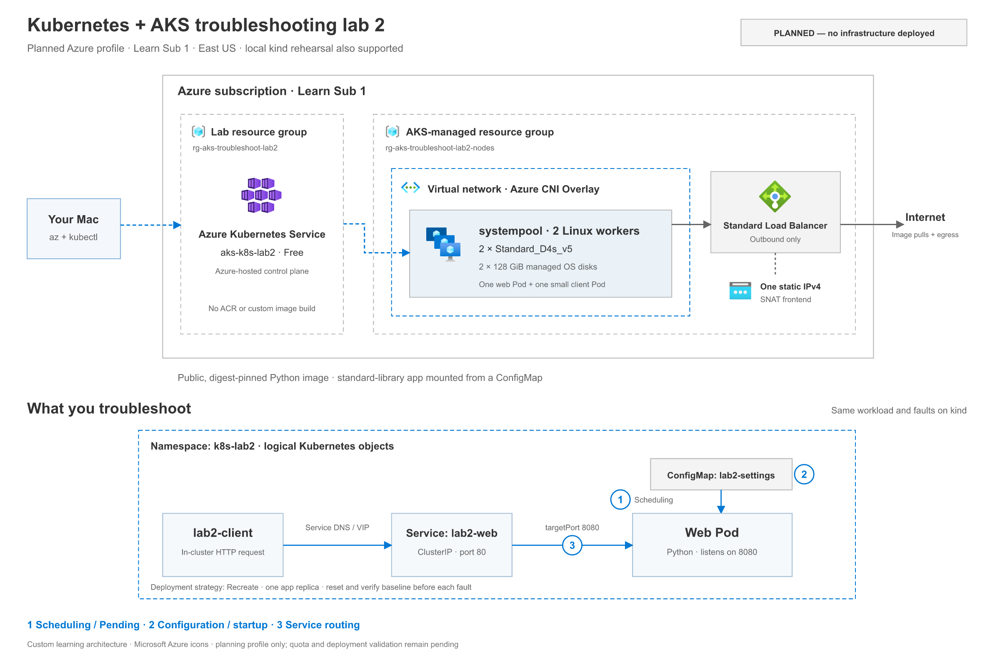

# Lab 2 architecture — planned

**No infrastructure deployed.** The Azure profile below is a reviewed plan; quota and ARM validation are still pending. A local kind cluster can run the same logical workload without Azure resources.

[Full-size PNG](aks-lab2-architecture.png) · [Scalable SVG](aks-lab2-architecture.svg)

## Azure resources

The dedicated group contains one AKS Free resource. AKS creates a separate managed group for a system pool with two Standard_D4s_v5 workers, two managed 128-GiB OS disks, VNet/node networking, one Standard outbound load balancer and its static IPv4 frontend. Exact generated network names/IPs are not asserted before deployment. The app shares this small learning pool; no additional user pool is planned.

Azure CNI Overlay assigns Pod addresses separately from the node VNet address range. The two lower boxes in the picture are views of physical infrastructure and logical workload, not extra sets of Pods or workers. The public IP is the load-balancer SNAT frontend, not a separate forwarding appliance.

There is no ACR or custom build. Both app and client use the same [digest-pinned Docker Official Python image](../references/image-lock.json). App source is mounted read-only from `lab2-web-code`; its message comes from a separate non-secret `lab2-settings` ConfigMap. A ClusterIP Service exposes port 80 internally and forwards to the app's 8080 listener. No public application load balancer, ingress, data disks or paid monitoring is planned.

## The three learning layers

1. **Scheduling:** the scheduler must find one eligible node that can satisfy the Pod's request. The helper's oversized CPU request exceeds every node's allocatable CPU, including on a local kind cluster.
2. **Configuration:** Kubernetes must resolve the required ConfigMap key before starting the container. A configuration-creation error occurs before application logs can exist.
3. **Routing:** the client calls Service DNS/VIP; the Service's backend port must match the application listener. Ready Pods and backend addresses alone do not establish end-to-end connectivity.

`lab.py probe` uses the in-cluster client for both Service and direct Pod-IP requests. A local `kubectl port-forward deployment/lab2-web 8080:8080` is an additional direct-to-Pod test; it does not exercise Service VIP routing. Deployment updates use Recreate, making one intended fault visible without a retained old healthy app replica masking it.

See the [walkthrough](../WALKTHROUGH.md), [costs](../costs/ESTIMATE.md), and [deployment review](../infra/DEPLOY.md). The diagram uses [official Microsoft Azure icons](https://learn.microsoft.com/en-us/azure/architecture/icons/); source terms and original hashes are retained in [diagram-assets/azure](diagram-assets/azure/README.md). Icons are embedded in the SVG, so the diagram has no external image dependencies.
